&nbsp;

&nbsp;

# João Marcos Ferreira Vilela

### Full-Stack Developer · Applied AI & Automation

I build web applications and automations that connect business workflows with AI. My projects include knowledge-grounded support assistants, AI-assisted reporting, API integrations and scheduling tools.

Based in **Caruaru, Brazil**. Open to **full-stack development and applied AI opportunities**.

## Selected projects

| Project | What it demonstrates |
| --- | --- |
| **[allchats](https://github.com/JaoVile/allchats)** | AI support assistant prototype with knowledge retrieval, Claude integration, tool calling, human handoff and a WhatsApp-style simulator. Includes a deterministic fallback for running without an API key. |
| **[API_Busca](https://github.com/JaoVile/API_Busca)** | Multi-tenant reporting automation: external API integrations, scheduled WhatsApp reports, encrypted credentials and optional AI-generated executive summaries. |
| **[checkout-diario](https://github.com/JaoVile/checkout-diario)** | Automation that collects local development activity and uses AI to draft work summaries, with configurable sources and an interface for reviewing the output. |
| **[agendapp](https://github.com/JaoVile/agendapp)** | Appointment scheduling PWA with Google Calendar synchronization and Google Meet integration. |
| **[Gnomon](https://github.com/JaoVile/Gnomon)** | Indoor wayfinding PWA with interactive maps and point-of-interest search. **Co-founder & Tech Lead.** |

## Technical focus

- **Applied AI:** LLM API integrations, retrieval-augmented generation (RAG), tool calling and human handoff workflows.
- **Frontend:** TypeScript, JavaScript, React, Next.js and Tailwind CSS.
- **Backend & data:** Python, FastAPI, Node.js, PostgreSQL and Supabase.
- **Quality & delivery:** Vitest, Playwright, Git, Docker and Linux.

## Contact

[Portfolio](https://joaovilela.vercel.app) · [LinkedIn](https://www.linkedin.com/in/joao-marcos-vilela-1106002b3/) · [Email](mailto:jaomarfervil@gmail.com)
